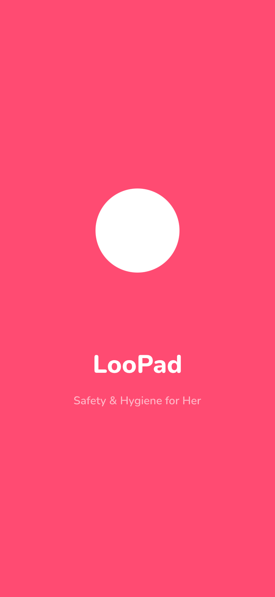
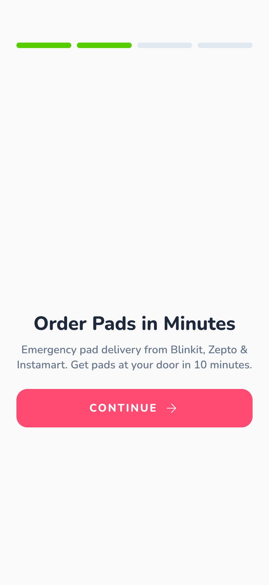
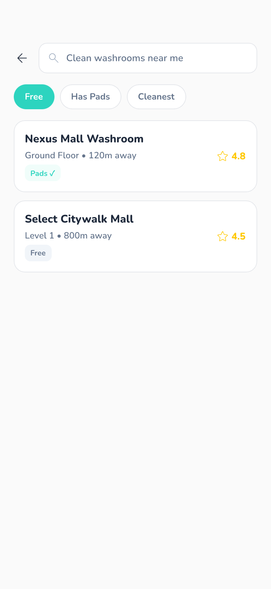
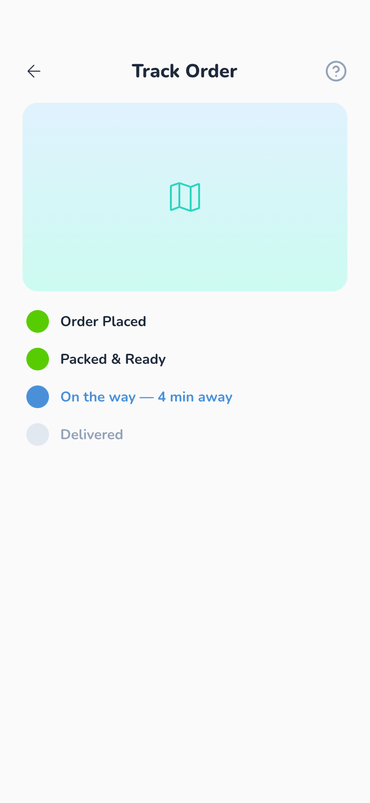
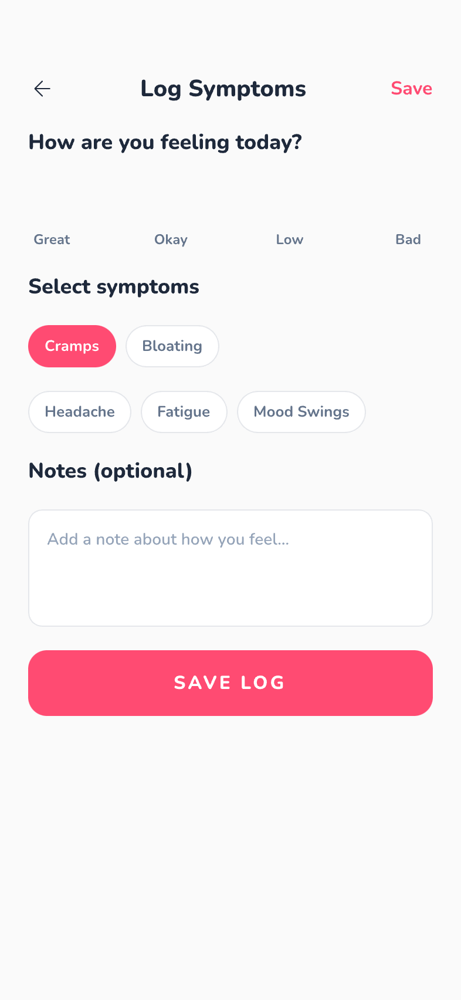
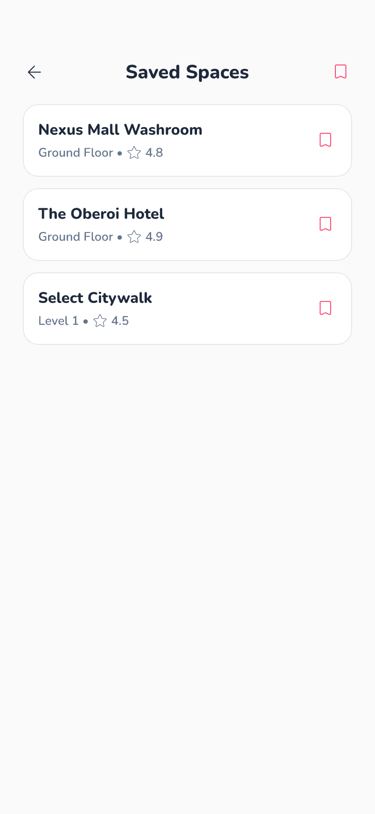
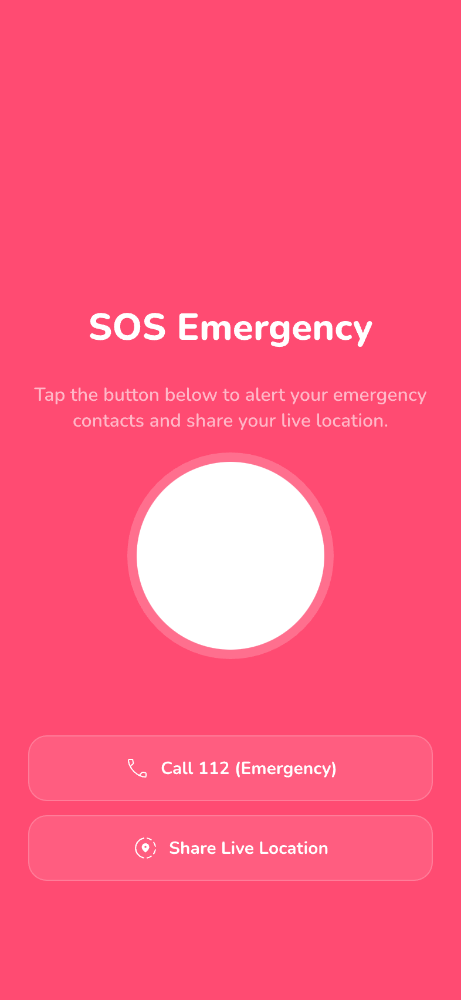
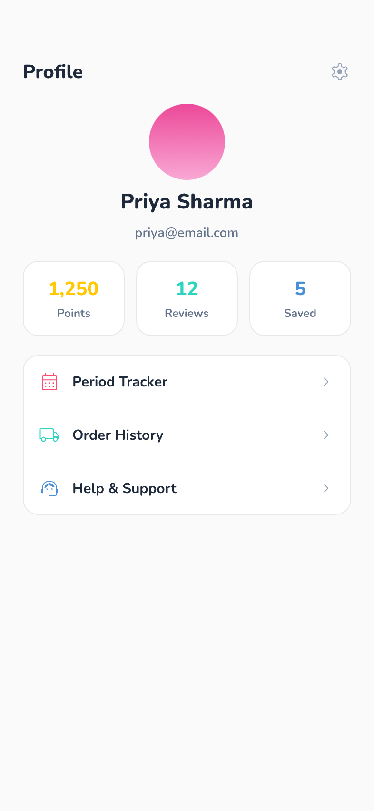

# 🧭 NavHer — Navigate Safely, Navigate Freely

**NavHer** is a mobile-first Flutter application designed to empower women with **safe navigation, hygiene access, and wellness tools** — all in one place. Built during the **WisCon Hackathon 2026**.

---

## 🌟 Problem Statement

Women in urban India face daily challenges — finding clean washrooms, accessing menstrual hygiene products in emergencies, tracking their period cycle, and identifying safe public spaces. NavHer brings all of these together into a single, beautifully designed app.

---

## 📱 Features

| Feature | Description |
|---|---|
| 🗺️ **Clean Washroom Finder** | Discover verified, hygienic washroom facilities for women across your city |
| 🚚 **Emergency Pad Delivery** | Order sanitary pads for urgent delivery to your location |
| 📅 **Period Tracker** | Log symptoms, track cycles, and get predictions |
| 🛡️ **Safe Spaces** | Find and navigate to verified safe public spaces nearby |
| 🏆 **Rewards** | Earn points for contributing reviews and helping the community |
| ⭐ **Rate & Review** | Rate washrooms and spaces to help other women |
| 🆘 **SOS Emergency** | Quick access to emergency contacts and services |

---

## 🖼️ Screenshots

Design mockups are available in [`loopad/designs/`](./loopad/designs/):

| Splash | Onboarding | Search Results | Order Tracking |
|--------|-----------|----------------|----------------|
|  |  |  |  |

| Period Tracker | Safe Spaces | SOS Emergency | Profile |
|----------------|-------------|---------------|---------|
|  |  |  |  |

---

## 🏗️ Tech Stack

- **Framework:** Flutter (Dart SDK ^3.11.1)
- **UI:** Material Design + Google Fonts + Custom Design System
- **Packages:** `google_fonts`, `url_launcher`, `cupertino_icons`
- **Design:** Custom app theme with dedicated color palette and reusable widgets

---

## 📂 Project Structure

```
wc-project/
├── loopad/                          # Main Flutter application
│   ├── lib/
│   │   ├── main.dart                # App entry point & route definitions
│   │   ├── screens/
│   │   │   ├── onboarding_screen.dart
│   │   │   ├── home_screen.dart
│   │   │   ├── pad_delivery_screen.dart
│   │   │   ├── washroom_details_screen.dart
│   │   │   ├── period_tracker_screen.dart
│   │   │   ├── rewards_screen.dart
│   │   │   └── safe_spaces_screen.dart
│   │   ├── theme/                   # App colors & theme configuration
│   │   └── widgets/                 # Reusable UI components
│   ├── designs/                     # 13 screen design mockups (PNG)
│   ├── android/                     # Android platform config
│   ├── ios/                         # iOS platform config
│   └── web/                         # Web platform config
├── emergency_pad_delivery_*/        # HTML prototypes for pad delivery flow
├── loopad_home_safe_spaces_nearby/  # HTML prototype for safe spaces
└── README.md
```

---

## 🚀 Getting Started

### Prerequisites

- [Flutter SDK](https://flutter.dev/docs/get-started/install) (3.11.1+)
- Android Studio / Xcode for emulator
- A connected device or emulator

### Installation

```bash
# Clone the repository
git clone https://github.com/jakharankit/wc-project.git
cd wc-project/loopad

# Install dependencies
flutter pub get

# Run the app
flutter run
```

---

## 🛣️ App Routes

| Route | Screen |
|---|---|
| `/onboarding` | Welcome & feature introduction |
| `/home` | Main dashboard |
| `/pad-delivery` | Emergency pad ordering |
| `/washroom-details` | Washroom info & reviews |
| `/period-tracker` | Cycle tracking & symptom logging |
| `/rewards` | Community points & achievements |
| `/safe-spaces` | Nearby safe locations map |

---

## 👥 Team

Built with ❤️ at **WisCon Hackathon 2026**

---

## 📄 License

This project is for hackathon/educational purposes.
