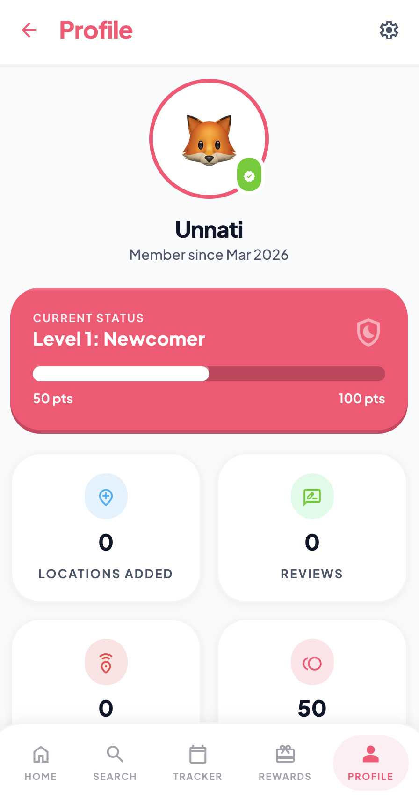
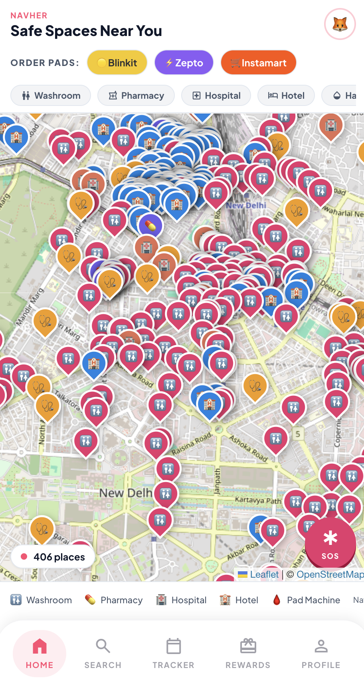
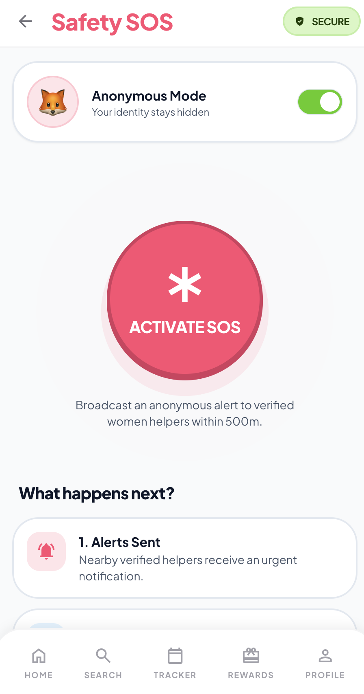
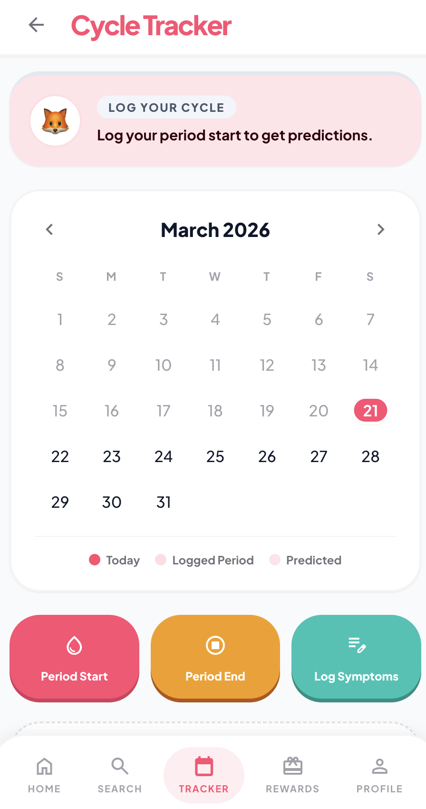
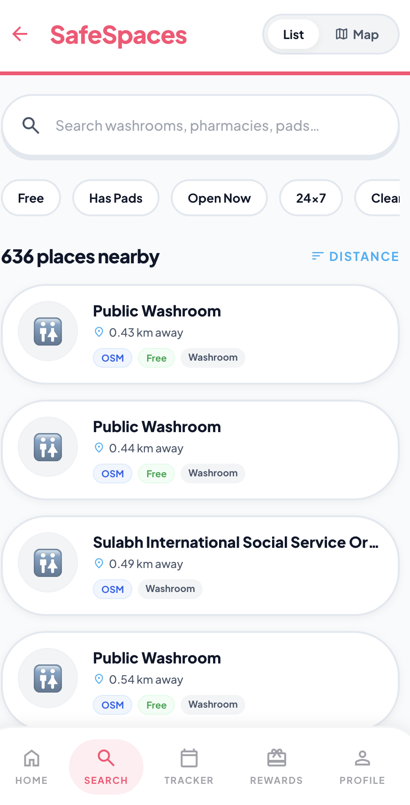

# 🧭 NavHer — Navigate Safely, Navigate Freely

*Navigating women safely to hygiene, help, and verified public spaces.*

[🔴 **Live Demo: navher-app-wiscon.web.app**](https://navher-app-wiscon.web.app)

**NavHer** is a mobile-first web application designed to empower women with **safe navigation, hygiene access, and wellness tools** — all in one place. Built during the **WisCon Hackathon 2026**.

---

## 💡 Inspiration
We realized there is a critical gap in urban infrastructure for women. While navigation apps show the fastest route, they don't show the *safest* route. Finding clean washrooms or accessing menstrual hygiene products in emergencies is a constant struggle. We built NavHer to bring safe routing, emergency SOS, and hygiene access into a single, cohesive platform.

## 🌟 Problem Statement
Women in urban India face daily challenges — finding clean washrooms, accessing menstrual hygiene products in emergencies, tracking their period cycle, and identifying safe public spaces. NavHer brings all of these together into a single, beautifully designed app.

---

## 📱 Features

| Feature | Description |
|---|---|
| 🗺️ **Clean Washroom Finder** | Discover verified, hygienic washroom facilities for women across your city |
| 🚚 **Emergency Pad Delivery** | Order sanitary pads for urgent delivery to your location |
| 📅 **Period Tracker** | Log symptoms, track cycles, and get predictions |
| 🛡️ **Safe Spaces** | Find and navigate to verified safe public spaces nearby |
| 🏆 **Rewards** | Earn points for contributing reviews and helping the community |
| ⭐ **Rate & Review** | Rate washrooms and spaces to help other women |
| 🆘 **SOS Emergency** | Quick access to emergency contacts and services |

---

## ⚙️ How It Works (Workflow)

NavHer is designed for simplicity and speed during critical moments:

1. **📍 Location & Context** — Upon opening the app, it instantly fetches your current location to show nearby safe spaces, washrooms, and pad vending machines.
2. **🛡️ Safety First Routing** — Unlike standard maps, the routing algorithm prioritizes *safe* paths based on crowd data, lighting, and community reviews.
3. **🆘 One-Tap SOS** — In emergencies, tapping SOS instantly alerts your emergency contacts and the nearest verified community helpers.
4. **🛍️ Seamless Ordering** — If you need hygiene products, the app connects directly with dark store APIs (like Zepto/Blinkit) for ~10 minute delivery.
5. **⭐ Community Review** — After your journey or washroom visit, you can drop a quick rating to help other women make informed decisions.

*(Demo GIFs capturing full app workflows will be attached soon)*

---

## 🖼️ Screenshots

|  |  |  |
|:---:|:---:|:---:|
| **Home & Safe Map Tracker** | **Emergency SOS Activation** | **Community Rewards** |

|  |  | 
|:---:|:---:|
| **Emergency Pad Delivery** | **User Profile & Tracker** |

---

## 🏗️ Tech Stack

- **Frontend:** React, Vite
- **Styling:** Tailwind CSS
- **Routing:** React Router DOM
- **Backend/Database:** Firebase (Auth, Firestore)
- **Deployment:** Firebase Hosting
- **Icons:** Lucide React

---

## 📂 Project Structure

```
navher/
├── src/
│   ├── components/       # Reusable UI components (Navbar, Map, etc.)
│   ├── pages/            # Main application screens (Home, SOS, Rewards)
│   ├── App.jsx           # App entry point & routing configuration
│   ├── index.css         # Global Tailwind styles
│   └── main.jsx          # React DOM rendering
├── public/               # Static assets
├── index.html            # HTML entry point
├── tailwind.config.js    # Tailwind configuration
├── package.json          # Dependencies and scripts
└── firebase.json         # Firebase hosting configuration
```

---

## 🚀 Getting Started

### Prerequisites

- [Bun](https://bun.sh/) installed locally.

### Installation

```bash
# Clone the repository
git clone https://github.com/Ankush-Jha/navher.git
cd navher

# Install dependencies using Bun
bun install

# Run the development server
bun run dev
```

---

## 🛣️ App Routes

| Route | Screen |
|---|---|
| `/auth/*` | Onboarding, Login, and Setup screens |
| `/app/map` | Main dashboard and Safe Spaces map |
| `/app/list` | Search list for safe spaces |
| `/app/emergency` | Emergency pad ordering |
| `/app/tracker` | Cycle tracking & symptom logging |
| `/app/rewards` | Community points & achievements |
| `/app/sos` | Quick access to emergency contacts and services |
| `/app/profile` | User profile and settings |

---

## 🚧 Challenges We Ran Into
Integrating real-time map features while maintaining a mobile-responsive, app-like feel on the web was difficult. We also had to design a trust-first monetization strategy that ensures the app remains 100% free and safe for the end-users while being a sustainable business.

## 🏆 Accomplishments That We're Proud Of
We successfully built a complete ecosystem addressing multiple facets of women's safety and wellness. The seamless transition between SOS features, safe routing, and emergency pad delivery within a single unified interface is something we are extremely proud of designing during the hackathon.

---

## 💰 Monetization Strategy

NavHer follows a **trust-first monetization approach**. Our core principle is that **monetization must never compromise safety or accessibility**.

> 💡 **NavHer core functionality, including the SOS network and navigation, will always remain 100% free for users.**

### 🛒 1. Emergency Pad Delivery (Affiliate Commissions)
NavHer integrates with instant delivery platforms such as **Blinkit, Zepto, and Instamart** to provide quick access to sanitary products.
- **Revenue Model:** Commission earned per order (₹5–₹20 or platform-based %) processed through our external delivery partners.

### ⭐ 2. Sponsored Safe Spaces (B2B Revenue)
Businesses can promote themselves as verified women-safe locations on the platform.
- **Revenue Model:** Subscription-based premium listings for approved businesses (₹999 – ₹4999/month per location), giving them highlighted pins on the map.

### 🎯 3. Location-Based Offers (Ethical Ads)
NavHer provides contextual and non-intrusive promotions based on the user's location (e.g., safe accommodation deals or pharmacy discounts).
- **Revenue Model:** Paid, vetted promotions from local businesses. *Only relevant and safety-aligned offers are displayed to maintain user trust.*

**⚠️ Core Principle:**
- ❌ No intrusive or irrelevant ads
- ❌ No misuse of personal data
- ❌ **No subscriptions or charges for users to access safety features**
- ✅ Focus on utility-driven B2B revenue and affiliate partnerships

---

## 🔮 Future Plans

| Feature | Description | Status |
|---------|-------------|--------|
| 🧭 **Safe Route Navigation** | Suggests the safest route instead of just the shortest by analyzing crowd density, street lighting, user reviews, and reported incidents. | 🧪 Planned |
| 🛣️ **Smart Route Washroom Planner** | Plans journeys by mapping verified washrooms along the route, sending timely reminders, and alerting users about long gaps without facilities. | 🧪 Planned |
| 📡 **Offline Support Mode** | Ensures critical features work without internet by switching to SMS/call mode for SOS and enabling pad assistance requests with location sharing. | 🧪 Planned |
| 🚨 **Emergency SOS Escalation** | In case of danger, escalates alerts beyond nearby helpers to ensure rapid response, with continuous location sharing and priority emergency handling. | 🧪 Planned |
| 🧠 **Location Safety Score** | Assigns a safety rating to locations based on crowd density, lighting, user reviews, and incident data — helping users quickly identify safer options. | 💡 Ideation |

---

## 👥 Team

Built with ❤️ at **WisCon Hackathon 2026** by Team NavHer.

---

## 📄 License

This project is for hackathon/educational purposes.
